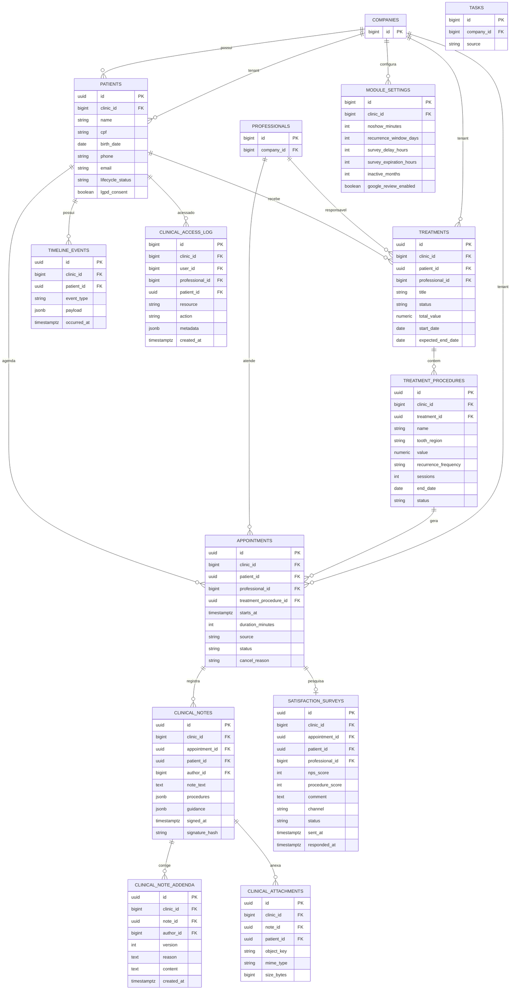

# Fase 3 — Modelo entidade-relacionamento

`clinic_id` em todas as entidades abaixo referencia `companies.id` e é
obrigatório. Entidades legadas (agenda, CRM e financeiro) serão referenciadas
por FK opcional somente quando o contrato existente for confirmado.

## Entidades, índices e integridade

- **patients:** nome/data de nascimento obrigatórios; CPF opcional, mas único por
  clínica quando informado. Índices por `(clinic_id, name)`, telefone, CPF e
  lifecycle. Consentimento LGPD exige versão e data quando marcado.
- **treatments:** paciente, profissional, título e status obrigatórios; valor
  não negativo. Índices por clínica/paciente/status.
- **treatment_procedures:** tratamento e frequência obrigatórios; frequência
  personalizada exige parâmetro validado. Sessões ou data final são obrigatórias
  para recorrência. Índice por tratamento/status.
- **appointments:** paciente, profissional, início, duração e status
  obrigatórios. `clinic_id` deve coincidir com paciente, profissional e
  procedimento; índice por clínica/início/status e prevenção de duplicata.
- **clinical_notes:** somente atendimento concluído/compareceu; texto e autor
  obrigatórios. Trigger/política impede update/delete após `signed_at`.
- **clinical_note_addenda:** versão única por nota, autor e motivo obrigatórios;
  nunca altera o conteúdo original.
- **clinical_attachments:** `object_key` não contém PII fora do bucket privado;
  tamanho/MIME limitados e nota/paciente pertencem à mesma clínica.
- **satisfaction_surveys:** scores com CHECK (NPS 0–10; procedimento 1–5);
  uma pesquisa por atendimento; janela de expiração aplicada pelo job.
- **timeline_events:** somente append para eventos de domínio; payload não pode
  incluir conteúdo clínico em eventos consumidos pela IA.
- **clinical_access_log:** append-only, sem endpoint de edição/exclusão; índice
  `(clinic_id, patient_id, created_at)`.
- **module_settings:** uma linha por clínica, defaults 30/90/2/72/6; valores
  positivos e timezone válido.

## RLS e acesso

Cada tabela aplica `USING (clinic_id = current_setting('app.clinic_id')::bigint)`
e `WITH CHECK` equivalente. O serviço define o contexto transacional após
validar o usuário; ausência de contexto nega a operação. Views administrativas
removem campos clínicos para Atendimento e Master. Jobs abrem uma transação por
clínica e nunca reutilizam contexto entre tenants.
